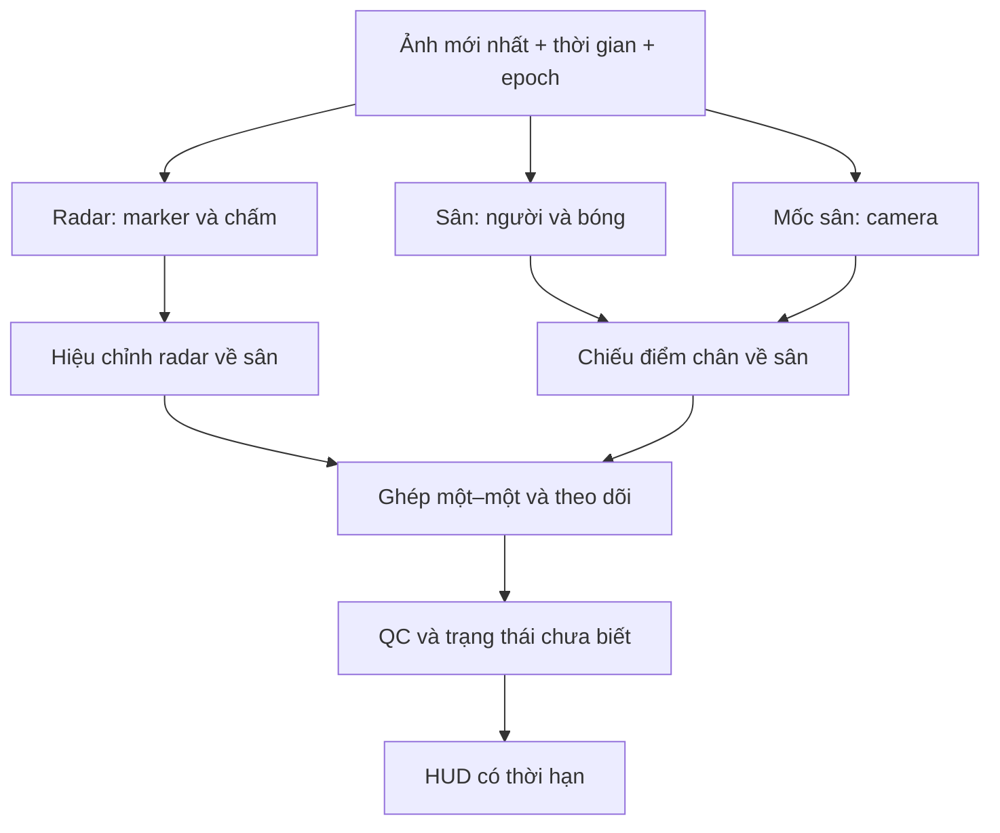

# Từ ảnh màn hình tới trạng thái trận đấu

Mục tiêu là hợp nhất các quan sát có bằng chứng. Camera game chỉ thấy một phần sân; cầu thủ ngoài camera cần quan sát từ radar. Khi cả hai nguồn bị che/khuất thì vị trí trở thành chưa biết, không tự sinh đủ 22 cầu thủ.

## Hợp đồng dữ liệu

`FusionInput` dùng cùng đồng hồ monotonic và cùng `epoch`. `Observation.point` đã phải ở tọa độ sân `[0,1]²`; tọa độ pixel/crop không tự tương đương tọa độ sân. `FieldDetection.box` là bbox trong ảnh gốc sau bỏ letterbox. Chiếu điểm giữa cạnh đáy bbox qua camera hợp lệ, không dùng tâm bbox cầu thủ.

Một hiệu chỉnh camera cần ít nhất sáu mốc inlier, đủ độ phủ không gian, tỷ lệ inlier ≥65%, P95 sai số chiếu ≤3 pixel ảnh gốc, không quá 200 ms và cùng epoch. RANSAC không giải quyết nhãn mốc sai hệ thống; thứ tự 32 mốc phải được xác minh bằng hình có đánh số trước khi nối detector pose.

Chỉ ghép hai nguồn lệch ≤60 ms, đội tương thích và khoảng cách trong ngưỡng. Hungarian tránh ghép hai cầu thủ vào cùng một người. Timestamp nguồn chỉ dùng một lần; ảnh cũ không gia hạn track. Track xác nhận sau ba quan sát, dự đoán ngắn hạn tối đa 300 ms, sau đó hết hạn. Đây là tracker vị trí cơ bản; chưa có embedding ReID và chưa đo IDF1 trên video thật.

## Trạng thái triển khai

| Nhánh | Có thể chạy | Còn thiếu để nghiệm thu |
|---|---|---|
| Minimap ONNX | Nhập ZIP, suy luận, marker, track chấm | Nhãn Mobile, phân đội, hiệu chỉnh mép sân radar, negative scenes |
| Cầu thủ/bóng trên sân | Dữ liệu đã audit/chuẩn hóa, runner train | Trọng số, runtime detector, kiểm tra bị che khuất và bóng trên không |
| Camera/32 mốc | Dữ liệu pose, RANSAC và test lõi | Bảng tên 32 mốc đã duyệt, trọng số pose, nối runtime, reset khi cut |
| Ghép hai nguồn | Lõi JVM và regression tests | Replay có nhãn ID liên tục để đo sai ghép/IDF1 |
| Gợi ý chiến thuật | Cổng khóa theo chất lượng | Nhãn bóng thật, đội, tình huống và đánh giá người chơi |

Hiện `modelsValidated=false` ở Android. Không có thanh phần trăm “thông minh”, vị trí bóng giả hoặc homography cố định. Màu cỏ chỉ là bộ lọc scene thô để nghiên cứu; các cảnh game plan/replay/live vẫn phải được gán nhãn và đo riêng.

## Hiệu năng

Capture và suy luận nối tiếp trên worker, `acquireLatestImage`, không giữ hàng đợi frame. Crop sao chép ROI từ buffer RGBA theo row/pixel stride; mô hình dùng lại Bitmap và input tensor. ONNX session CPU một thread, không chạy cùng luồng UI. Kết quả truyền immutable và vẽ ở main thread. Marker không nằm trên radar gốc để giảm vòng phản hồi overlay → capture.

Tần suất 15 Hz là giới hạn yêu cầu, không phải thông lượng đã đo. Bản hiện không có đường AHardwareBuffer/GPU zero-copy, OpenCV NDK hay NNAPI. Cần đo trước khi thêm backend: giảm sao chép không bù được mô hình sai hoặc dữ liệu khác thiết bị.
